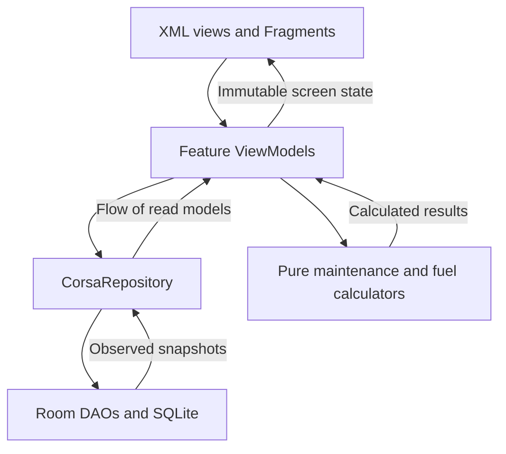
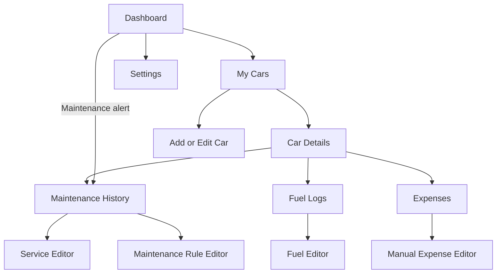

# CORSA

Reviewed 2026-11-09. Architecture baseline for a cars-first Android vehicle ownership application. The proposal is complete according to the owner. The design below is proposed for implementation, not a description of existing code.

[[Projects/Corsa/STATUS|Status]] · [[Projects/Corsa/decisions|Decisions]] · [[Projects/Corsa/progress|Progress]] · [[Projects/Projects|Projects]]

## Purpose and initial scope

Help car owners, students, daily commuters, and people with multiple cars keep vehicle records in one local application. The distinguishing feature is explainable maintenance tracking based on mileage, time, and service history.

Cars first is confirmed by the owner. The proposed initial implementation includes multiple car profiles, maintenance history and intervals, fuel logs and efficiency, expenses, a dashboard, and basic analytics. Motorcycle support is deferred. Documents, depreciation, background notifications, and advanced analytics remain optional later work.

## Stack and deployment boundary

Use Kotlin, XML layouts with Material components, Room over SQLite, and MVVM, as specified in the project brief. Choose one Activity with Fragments and a Navigation Component graph. Use coroutines and Flow for database observations and immutable screen state.

One `:app` Gradle module is sufficient. Package boundaries separate responsibilities without separate domain and data build modules. Construct dependencies in a small `AppContainer`. Do not add a dependency injection framework, network layer, account system, or synchronization service for the initial local application.

The application repository is at `/Users/aaronarada/AndroidStudioProjects/Corsa`. Android minimum SDK, dependency versions, chart library, team assignments, and delivery dates are not yet recorded. These notes do not establish instructor approval.

## Package ownership

```text
app/                          Application, MainActivity, AppContainer
data/local/                   CorsaDatabase, entities, DAOs, migrations
data/CorsaRepository          Validated writes and aggregate read queries
model/                        Input drafts, read models, save outcomes
calculation/                  MaintenanceCalculator, FuelCalculator
ui/dashboard/                 Dashboard Fragment, ViewModel, screen state
ui/vehicles/                  Car list, details, and editor
ui/maintenance/               History, service editor, interval editor
ui/fuel/                      Fuel history, editor, statistics
ui/expenses/                  Unified spending history and manual editor
ui/analytics/                 Basic charts and period selection
ui/settings/                  Application preferences
res/layout/                   XML screens and list items
res/navigation/               Navigation graph
```

The repository owns database writes, cross-record validation, transactions, and spending projections. ViewModels call it directly. Introduce no pass-through use-case classes or repository interfaces until another implementation or substantial independent policy requires them.

Calculators receive ordinary Kotlin values and an explicit date. They own the maintenance and fuel formulas and have no Android or Room dependency. Fragments render state, collect it with their view lifecycle, and forward user actions. They do not write through DAOs or compute ownership totals.

## User actions and data flow

A maintenance form saves one service record through the repository. The repository validates its car and rule, writes the record, and raises the car's known mileage when needed in one transaction. Observers then receive fresh history, spending, and service status. The form never creates a second expense record.



These Kotlin signatures are contracts for future code, not implemented APIs. The save pattern applies to cars, rules, fuel logs, and manual expenses as well.

```kotlin
suspend fun saveMaintenance(draft: MaintenanceDraft): SaveOutcome
suspend fun deleteMaintenance(id: Long): DeleteOutcome
fun observeVehicleSnapshot(vehicleId: Long): Flow<VehicleSnapshot?>
fun observeSpending(vehicleId: Long?, period: DateRange): Flow<List<SpendingItem>>
fun calculateMaintenance(rule: MaintenanceRule, history: List<MaintenanceRecord>, currentMileageKm: Long, today: LocalDate): MaintenanceStatus
fun calculateFuel(logs: List<FuelRecord>): FuelSummary
```

`SaveOutcome` distinguishes a saved ID, field validation errors, and a missing car or rule. `DeleteOutcome` distinguishes deleted and already missing. Unexpected storage failures become visible retryable screen errors. Keep entered values after a failed save and prevent duplicate submissions while a save is active. Store editor IDs and small draft fields in `SavedStateHandle`.

## Room schema

All five tables support CRUD. IDs, kilometer readings, and money in minor currency units use `INTEGER`, mapped to Kotlin `Long`. Liters use `REAL`, mapped to `Double`. Text dates use ISO `YYYY-MM-DD`. Fuel observations additionally store local time for ordering same-day fills. Nullable fields are marked `?`.

| Table | Fields |
| --- | --- |
| `vehicle` | `id` PK, `brand` TEXT, `model` TEXT, `year` INTEGER, `plateNumber` TEXT?, `currentMileageKm` INTEGER, `photoPath` TEXT? |
| `maintenance_rule` | `id` PK, `vehicleId` FK, `name` TEXT, `intervalKm` INTEGER?, `intervalDays` INTEGER?, `baselineMileageKm` INTEGER?, `baselineDate` TEXT?, `warningKm` INTEGER, `warningDays` INTEGER |
| `maintenance_log` | `id` PK, `vehicleId` FK, `ruleId` FK?, `date` TEXT, `mileageKm` INTEGER, `costMinor` INTEGER, `description` TEXT |
| `fuel_log` | `id` PK, `vehicleId` FK, `purchasedAt` TEXT, `mileageKm` INTEGER, `liters` REAL, `costMinor` INTEGER, `tankState` TEXT |
| `expense` | `id` PK, `vehicleId` FK, `date` TEXT, `category` TEXT, `costMinor` INTEGER, `description` TEXT |

Each car has many rules, maintenance logs, fuel logs, and manual expenses. Each rule has many maintenance logs. A log can have no rule for one-off repairs. All `vehicleId` foreign keys reference `vehicle.id` and cascade on car deletion. Deleting a rule sets linked `ruleId` values to null and preserves history. Inside the transaction, reject a rule belonging to another car.

Index every foreign key, maintenance queries by `(vehicleId, ruleId, date)`, fuel queries by `(vehicleId, purchasedAt)`, and expenses by `(vehicleId, date)`. Use the ID as a stable tie-breaker when sorting. After release, change the schema with explicit migrations. Do not use destructive migration as the normal upgrade path.

### Spending has one source per transaction

Fuel costs exist only in `fuel_log`. Service and repair costs exist only in `maintenance_log`. `expense` holds other spending such as registration, insurance, accessories, parking, and tolls.

An observed `UNION ALL` query projects these sources into `SpendingItem(sourceType, sourceId, vehicleId, date, category, costMinor)`. Totals sum that projection once. Selecting a fuel or maintenance item opens its source editor. No companion expense rows are synchronized. Manual categories exclude fuel and maintenance to prevent ordinary duplicate entry.

Use one configured currency throughout the app, fixed once financial records exist. The actual currency remains to be chosen. Parse decimal input into integer minor units at the form boundary. Never add unlike currencies or use floating-point values for money.

### Validation and deletion

Require brand, model, valid year, nonnegative mileage and cost, positive liters, and valid record dates. Completed service, expense, and fuel dates cannot be in the future. Intervals must be positive when enabled, with at least one enabled interval. Warning values must be nonnegative. Allow a rule with incomplete baseline information to be saved as `NeedsBaseline`. Each enabled interval needs its corresponding anchor before a deadline can be calculated.

Validate dated fuel and service readings against neighboring observations within the same car. Historical records may be below today's mileage. Reject readings that make mileage decrease across calendar days, or across timed fuel purchases on the same day. A date-only service record does not assert a time relative to same-day fuel purchases. Recheck database-dependent constraints inside the write transaction.

Saving a reading raises `currentMileageKm` to the greater of the saved reading and current value. Editing or deleting history does not lower the physical odometer. A manual downward correction must remain at or above every retained reading. Reassigning a historical record to another car is not an editor action.

Car deletion requires confirmation that its histories will also be deleted. Commit the cascade atomically. Store photos as app-private files, with paths in Room. After a committed deletion or photo replacement, remove unreferenced photos. A missing photo shows a placeholder rather than breaking the car record.

## Maintenance calculation contract

For each rule, use its latest linked completed service as the anchor, ordered by service date, then mileage, then ID. That service supplies both the mileage and calendar anchors. If none exists, use the explicit rule baseline. Never assume a used car was last serviced at zero kilometers or on its purchase date.

- Mileage deadline = anchor mileage + `intervalKm`.
- Calendar deadline = anchor date + `intervalDays`.
- Remaining kilometers = mileage deadline minus current mileage. Keep negative values to explain overdue distance.
- Remaining days = calendar deadline minus today's date.

An exceeded enabled limit means `Overdue`. Otherwise, reaching either limit exactly means `DueNow`. Otherwise, entering either configured warning range means `DueSoon`. Remaining valid rules are `Scheduled`. Missing required anchors produce `NeedsBaseline`.

For example, service at 20,000 km with a 5,000 km interval is due at 25,000 km. At 24,200 km, 800 km remain. At 25,000 km it is due, and at 25,100 km it is overdue by 100 km. These are design examples, not executed tests.

Show the reference service, limits, and reason for every status. Recompute after history or rule changes and when the local date changes or the app resumes. Do not persist calculated statuses or totals. A calendar estimate based on average driving distance is deferred. Owners configure intervals from their car's service guidance rather than a universal default.

## Fuel calculation contract

`tankState` has values `FULL`, `PARTIAL`, and `GAP`. A GAP-marked purchase still counts toward spending but declares incomplete measurement history and breaks the efficiency segment.

Use consecutive full-tank anchors. Distance is the closing odometer minus the opening odometer. Divide by all liters purchased after the opening fill through the closing fill, including intervening partial fills. Exclude the opening fill's liters.

For example, a full fill at 10,000 km, a 10-liter partial fill, and a 20-liter full fill at 10,450 km give `450 / 30 = 15 km/L`. A GAP, missing full anchor, or nonpositive distance produces insufficient data for that segment. After a GAP, the next FULL establishes a fresh baseline.

Period efficiency is total eligible distance divided by total eligible liters, not the average of interval ratios. Assign a complete interval to its closing-fill date and label charts accordingly. Read earlier history when needed to find an interval's opening anchor. Fuel spending includes all purchases, even those excluded from efficiency.

## Navigation

Bottom navigation contains Dashboard and Settings. The populated Dashboard links to My Cars for vehicle management; Analytics is deferred from primary navigation. Dashboard has an all-cars summary and links to car-specific records. Each detail or editor receives a car ID and, when needed, a record ID. Reload records from Room instead of passing mutable entities.



The empty dashboard offers Add Car. Missing or deleted records show an explanation and a route back. Forms need accessible labels, field-level errors, and preserved input. Basic charts cover fuel efficiency and spending by month and category, with readable text summaries.

## Visual direction and UI architecture

The owner selected [A car maintenance app concept by Lay](https://dribbble.com/shots/27346135-A-car-maintenance-app-concept) on 2026-11-09. The page describes a dark mechanical interface, strong typography, and vehicle renders, with a black, graphite, and cool-gray palette. Those are the approved reference direction. The specifications below are Corsa adaptations, not measured properties of the shot.

The signature is a prominent car image paired with real mileage and the next maintenance deadline. Give this treatment to Car Details and the selected-car dashboard. Use compact rows for history and quieter surfaces for data entry. Do not invent a vehicle health score without an agreed formula and supporting data.

Apply apple-design's hierarchy, accessibility, typography, and branding principles while retaining Android components and back behavior. This is an Android XML/Material app. Apple-specific navigation, fonts, and Liquid Glass are not architectural requirements.

### Theme tokens

Define named colors and text appearances centrally under `res/values/` and dark overrides under `res/values-night/`. Avoid per-screen color literals. Follow the system appearance with a corresponding light treatment. Dark mode is the primary visual reference.

| Role | Dark | Light adaptation |
| --- | --- | --- |
| Background | `#000000` | `#F5F7F8` |
| Raised surface | `#3B3D42` | `#FFFFFF` |
| Primary content | `#E5ECEE` | `#16181C` |
| Secondary content | `#A3ADB7` | `#515A64` |
| Warning content | `#F3C969` | `#755500` |
| Error content | `#FFB4AB` | `#A32124` |

The dark background, raised surface, and primary content start from the page's published palette. Secondary text is lightened from its published `#9DA6B0`, which calculates to 4.41:1 on the raised surface. The replacement calculates to 4.77:1. All listed content colors calculate to at least 4.77:1 against either dark surface and 6.40:1 against either light surface. These are opaque sRGB token calculations, not measurements of rendered screens. Warning, error, and light-mode colors are proposed adaptations. Use a primary-content fill with background-colored text for the main action. Pair status colors with icons and words.

Use Android's system sans-serif with a restrained scale of 32sp for the main mileage figure, 24sp for a screen title, 20sp for section headings, 16sp for body and controls, and 14sp for secondary labels. Prefer regular, medium, and bold weights. Keep units beside values and use tabular digits for comparable metrics.

Proposed layout tokens are 20dp page margins, an 8dp spacing rhythm, and 16dp surface corners. Preserve at least 48dp touch targets. These values are Corsa design judgments. Use scalable text and content-driven heights rather than shrinking important text to fit.

### Screen composition

On compact widths, place the car selector above the image, mileage, and next-service status. Show Log fuel and Record service actions next, then the urgent service list and monthly spending. An all-cars view uses compact car summaries and prioritizes overdue work. On wider widths, place the vehicle summary beside maintenance and spending. At large font scales, stack metrics and actions vertically.

```text
Compact                         Wider
Car selector                    Car selector
Car image                       Car image       Next service
Mileage and next service        Mileage         Service list
Log fuel | Record service       Quick actions   Spending summary
Upcoming services
Monthly spending
Dashboard | Settings             Dashboard | Settings
```

Use `MaterialToolbar`, `BottomNavigationView`, `MaterialButton`, `TextInputLayout`, `RecyclerView`, and standard date pickers. Expense and history rows show date, description, and a right-aligned amount. Forms retain persistent labels and inline errors. Avoid concealing records with blur. Use a static user photo or a neutral car illustration initially rather than a runtime 3D renderer. This preserves the vehicle focus without adding a rendering subsystem.

The hierarchy is specific to ownership decisions, with the next service immediately visible beside mileage. Remove a decorative health gauge and background motion. Any short transition must respect disabled system animations. Images may reinforce identity but must not determine whether records can be used.

### Design guidance and verification

- Apple `layout.md` under Visual hierarchy says "Order content by relative importance." Apply that by prioritizing overdue service over decorative imagery. [Layout guidance](https://developer.apple.com/design/human-interface-guidelines/layout).
- Apple `accessibility.md` under Vision says "Convey information with more than color alone." Use status text and icons, scalable text, and TalkBack labels. [Accessibility guidance](https://developer.apple.com/design/human-interface-guidelines/accessibility).
- Apple `branding.md` under Best practices says "Express your brand with familiar components." Apply that through Material controls and the car imagery. [Branding guidance](https://developer.apple.com/design/human-interface-guidelines/branding).
- Apple `typography.md` under Conveying hierarchy says "Minimize the number of typefaces you use". Use one system family with weight and size hierarchy. [Typography guidance](https://developer.apple.com/design/human-interface-guidelines/typography).

The reference's published description and palette were retrieved. Its full mockup image was not available for reliable pixel inspection. Validate the proposed tokens, all text-on-surface combinations, font scaling, TalkBack order, keyboard behavior, and light/dark screenshots against the rendered Android app before claiming visual conformance.

## Testing and implementation boundaries

Use local unit tests for pure calculations, Room instrumentation tests for persistence and transactions, and an end-to-end device or emulator check for the main workflow. The concrete backlog and expected checks are in [[Projects/Corsa/STATUS|Status]].

Add optional documents through a vehicle-linked table and migrations when approved for scope. Add WorkManager only when background reminders enter scope. A future worker must reuse the same maintenance calculator and repository rather than implement another status formula. Depreciation needs a separately agreed formula before implementation.

## AI development guidance and evidence

AI tools may help scaffold Kotlin and XML, explain Room queries, review calculations, and suggest edge cases. Developers must understand generated code, verify dependencies, run tests, and document actual results. Use synthetic vehicle data in prompts and tests.

Read this overview, [[Projects/Corsa/STATUS|Status]], and [[Projects/Corsa/decisions|Decisions]] before implementation. Follow the application repository's instructions once its location is known. Record only checks actually run in progress.

Sources are the owner's project brief and clarifications in the 2026-11-09 conversation. The architecture details are recommendations made during this session. No application repository or runtime was inspected.
